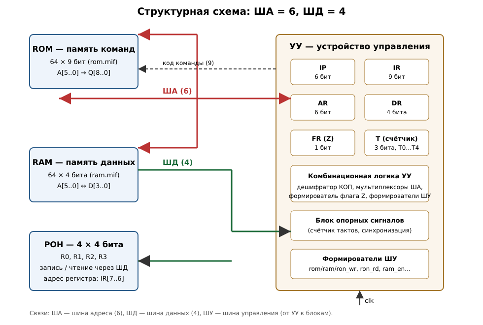
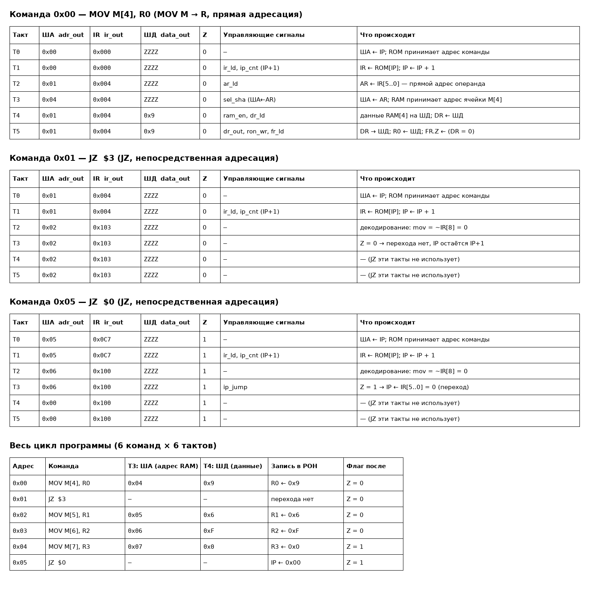

# Лабораторная работа № 4

## Считывание, декодирование и выполнение команд. Способы адресации операндов

**Вариант:** шина адреса (ША) — **6 бит**, шина данных (ШД) — **4 бита**;
команда 1 — **M → R** с **прямой** адресацией операнда-источника;
команда 2 — **JZ** с **непосредственной** адресацией адреса перехода;
блок РОН — **4 регистра**.

Проект Quartus II 9.1: `lab4.qpf` / `lab4.qsf`, верхний уровень — `laba4.bdf`.

---

## 1. Задание

1. Разработать архитектуру системы команд (АСК) для выданного варианта.
2. Ввести ША, ШД и ШУ.
3. Разделить память на память данных (RAM) и память команд (ROM); адресные входы
   обеих подключить к ША; ввод/вывод данных — через ШД.
4. Ввести блок РОН (4 регистра) и управляющую логику для него.
5. Написать микропрограмму из 4–6 вызовов команд с конкретными адресами и регистрами.
6. Записать микропрограмму в ROM (`rom.mif`), данные — в RAM (`ram.mif`).
7. Разработать УУ, которое считывает, декодирует и выдаёт управляющие сигналы.
8. Ввести специальные регистры, размещённые в блоке УУ.
9. Промоделировать схему.

---

## 2. Архитектура системы команд (АСК)

### 2.1 Шины и разрядности

| Шина | Обозначение в схеме | Разрядность | Назначение |
|---|---|---|---|
| Шина адреса | `address[5..0]` | 6 | адрес ячейки ROM/RAM (64 ячейки) |
| Шина данных | `data_io[3..0]` | 4 | обмен данными RAM ↔ РОН ↔ УУ |
| Шина управления | набор сигналов УУ | — | `ram_en`, `ram_wr`, `ron_wr`, `ron_rd`, `ron_addr[1..0]` |

Адресные входы ROM **и** RAM заведены на одну и ту же ША (п. 3 задания).
Шина данных — двунаправленная, с тремя формирователями (RAM, РОН, DR в УУ).

### 2.2 Память и регистры

| Блок | Организация | Файл инициализации |
|---|---|---|
| ROM — память команд | 64 слова × **9 бит** | `rom.mif` |
| RAM — память данных | 64 слова × **4 бита** | `ram.mif` |
| РОН | 4 регистра × **4 бита** (R0…R3) | инициализация не требуется |

Глубина памяти задана ША = 6 бит → 2⁶ = 64 ячейки; разрядность данных — ШД = 4 бита.

### 2.3 Формат команды

Слово команды — **9 бит** (порядок полей — как в методичке, «КОП x REG ADR»):

```
 8  │ 7  6 │ 5  4  3  2  1  0
────┼───────┼──────────────────
КОП │   R   │       ADR
(1) │  (2)  │       (6)
```

* **КОП** — код операции (1 бит): `0` — `MOV`, `1` — `JZ`;
* **R** — номер регистра-приёмника РОН (2 бита), для `JZ` не используется (`00`);
* **ADR** — адресное поле: физический адрес операнда в RAM для `MOV`
  либо адрес перехода для `JZ` (непосредственная адресация).

Разрядности полей определяются вариантом: адрес — разрядностью ША (6 бит →
64 ячейки), номер регистра — числом РОН (4 → 2 бита), КОП — числом команд в АСК.

> **Почему КОП один бит.** По варианту в АСК входят ровно две команды:
> пересылка `M → R` с прямой адресацией и переход с непосредственной адресацией
> (из группы `Jmp, Js, Jz` выбран `JZ`). Двух команд достаточно одному биту
> КОП: `0` — `MOV`, `1` — `JZ`. Команды `JMP` и `NOP` в АСК **не введены** —
> их нет в задании, а с двумя кодами поле КОП исчерпано полностью.

> **Почему слово команды шире ШД (9 > 4).** В нём нужно разместить 6-битный
> адрес, 2-битный номер регистра и код операции — 9 бит. Как и в примере из
> методички, команда не помещается в ШД, поэтому ROM имеет собственную выходную
> шину `rom_data[8..0]`, которая идёт в регистр команд IR. Регистры AR (6 бит)
> и DR (4 бита), ША (6) и ШД (4) строго соответствуют разрядностям задания.

### 2.4 Кодирование операций

| КОП | Команда | Формат | Действие |
|---|---|---|---|
| `0` | **MOV M→R** | `0 R ADR` | `R ← M[ADR]`; `Z ← (M[ADR] == 0)` |
| `1` | **JZ $ADR** | `1 00 ADR` | если `Z = 1`, то `IP ← ADR`, иначе `IP ← IP + 1` |

**Способы адресации по варианту:**

* **MOV M → R, прямая адресация:** в команде указывается физический адрес
  операнда в RAM (`ADR`) и номер регистра-приёмника (`R`).
  `Операнд = M[ADR]`, результат пишется в `R`.
* **JZ, непосредственная адресация:** адрес перехода находится непосредственно
  в команде (поле `ADR`), никаких дополнительных выборок из памяти нет:
  `IP ← ADR`.

Флаг `Z` (нулевой результат) — единственный флаг, используемый командой `JZ`.
Он устанавливается каждой командой `MOV` по значению переданного операнда
и хранится в регистре флагов `FR`.

> **Про незанятые ячейки ROM.** Кода `NOP` в АСК нет, поэтому ячейки `06…3F`
> (в них записаны нули) формально декодируются как `MOV M[0], R0`. До них
> управление не доходит: программа заканчивается командой `JZ $0`, которая
> при `Z = 1` возвращает `IP` на `00`, и счётчик команд за пределы адреса `05`
> не выходит.

---

## 3. Структурная схема



Текстовое описание связей:

* УУ выдаёт адрес на ША (мультиплексор: `IP` при выборке команды, `AR` при обращении к операнду);
* ША → адресные входы ROM и RAM;
* ROM → `rom_data[8..0]` → IR (регистр команд внутри УУ);
* RAM ↔ ШД (чтение — через формирователь с сигналом `ram_en`);
* РОН ↔ ШД (запись — `ron_wr`, чтение — `ron_rd`, адрес регистра — `IR[7..6]`);
* DR внутри УУ выдаёт данные на ШД при записи в РОН (`dr_out`);
* УУ формирует ШУ для RAM, РОН и внутренних регистров.

---

## 4. Устройство управления (УУ)

### 4.1 Специальные регистры (внутри блока `uu`)

| Регистр | Разрядность | Назначение |
|---|---|---|
| **IP** (PC) | 6 | счётчик команд: адрес очередной команды (равен разрядности ША) |
| **IR** | 9 | регистр команд (равен разрядности слова команды) |
| **AR** | 6 | регистр адреса операнда (равен разрядности ША) |
| **DR** | 4 | регистр данных (равен разрядности ШД) |
| **FR** | 1 | регистр флагов: флаг `Z` (результат равен нулю) |
| **T** | 3 | счётчик тактов автомата: состояния `T0…T4` (счёт по модулю 5) |

### 4.2 Автомат выполнения команды

Каждая команда выполняется за фиксированные **5 тактов** — `T0…T4`
(счётчик `T` считает по модулю 5, дешифратор `T_dec` имеет ровно пять выходов,
неиспользуемых состояний в схеме нет).

**Выборка команды (общая для всех команд):**

| Такт | Действие |
|---|---|
| `T0` | ША ← IP (мультиплексор в положении «IP»), ROM читает слово по адресу IP |
| `T1` | `IR ← ROM[IP]`; `IP ← IP + 1` |

**Выполнение MOV M → R:**

| Такт | Действие |
|---|---|
| `T2` | `AR ← IR[5..0]` (поле ADR) |
| `T3` | ША ← AR; RAM выдаёт `M[AR]` на ШД; `DR ← ШД` |
| `T4` | DR выдаёт данные на ШД; `R[IR[7..6]] ← ШД`; `FR.Z ← (DR == 0)` |

**Выполнение JZ $ADR:**

| Такт | Действие |
|---|---|
| `T2` | (декодирование) |
| `T3` | если `Z = 1`, то `IP ← IR[5..0]` (непосредственный адрес из команды) |

### 4.3 Управляющие сигналы (ШУ)

Обозначения: `mov = ~IR[8]`; `jump = IR[8] & Z`.

| Сигнал | Формула | Назначение |
|---|---|---|
| `sel_sha` | `T3 & mov` | выбор источника ША: 0 — IP, 1 — AR |
| `ir_ld` | `T1` | запись IR из ROM |
| `ip_en` | `T1 + (T3 & jump)` | разрешение записи IP |
| `ip_jump` | `T3 & jump` | выбор на входе IP адреса перехода `IR[5..0]` вместо `IP+1` |
| `ar_ld` | `T2 & mov` | запись AR из поля ADR |
| `ram_en` | `T3 & mov` | выдача данных RAM на ШД |
| `dr_ld` | `T3 & mov` | запись DR с ШД |
| `dr_out` | `T4 & mov` | выдача DR на ШД |
| `ron_wr` | `T4 & mov` | запись в РОН |
| `ron_addr[1..0]` | `IR[7..6]` | адрес регистра РОН |
| `fr_ld` | `T4 & mov` | запись флага `Z` |
| `ram_wr` | `0` | запись в RAM в данной АСК не используется (резерв) |
| `ron_rd` | `0` | чтение РОН в данной АСК не используется (резерв) |

В схеме `mov` — один инвертор (`NOT`) от разряда `IR[8]`, `jump` — один
элемент `AND2` (`IR[8]` и `Z`); остальные сигналы — элементы `AND2` от тактов
`T1…T4` и сигнала `mov`.

### 4.4 Формирование флага Z

```
Z = NOT( DR[3] OR DR[2] OR DR[1] OR DR[0] )
```

Флаг записывается в `FR` в такте `T4` команды `MOV` и анализируется
в такте `T3` команды `JZ` (к этому моменту предыдущая команда уже завершилась,
поэтому значение `Z` всегда актуально). В схеме это дерево из трёх элементов
`OR2` и одного `NOT`.

---

## 5. Микропрограмма

### 5.1 Символьная запись

| Адрес | Команда | Комментарий |
|---|---|---|
| `00` | `MOV M[4], R0` | `R0 ← 9`, `Z = 0` |
| `01` | `JZ $3` | `Z = 0` → **перехода нет**, идём на `02` |
| `02` | `MOV M[5], R1` | `R1 ← 6`, `Z = 0` |
| `03` | `MOV M[6], R2` | `R2 ← F`, `Z = 0` |
| `04` | `MOV M[7], R3` | `R3 ← 0`, `Z = 1` |
| `05` | `JZ $0` | `Z = 1` → **переход есть**, возврат на `00` (цикл) |
| `06…3F` | — | не используются |

В микропрограмме задействованы все четыре регистра РОН, обе команды варианта
и показаны оба исхода условного перехода: `JZ $3` (перехода нет) и `JZ $0`
(переход есть).

### 5.2 Числовой код программы

Формат команды — 9 бит: `КОП(1) | R(2) | ADR(6)`, т.е. `КОП = IR[8]`,
`R = IR[7:6]`, `ADR = IR[5:0]`.

**а) Код программы (символьная и числовая запись)**

| Адрес ROM | Символьно | BIN (9 бит) | HEX |
|---|---|---|---|
| `00` | `Mov ($4), R0` | `000000100` | **`004`** |
| `01` | `JZ $3` | `100000011` | **`103`** |
| `02` | `Mov ($5), R1` | `001000101` | **`045`** |
| `03` | `Mov ($6), R2` | `010000110` | **`086`** |
| `04` | `Mov ($7), R3` | `011000111` | **`0C7`** |
| `05` | `JZ $0` | `100000000` | **`100`** |

Здесь `$n` в команде `Mov` — прямой адрес операнда в памяти данных (RAM),
в команде `JZ` — непосредственный (абсолютный) адрес перехода в памяти команд (ROM);
поле `R` задаёт номер регистра-приёмника РОН (`00`…`11` = `R0`…`R3`).

**б) Разбиение кода команды по полям (по битам)**

| Адрес ROM | КОП | R1 | R0 | ADR5 | ADR4 | ADR3 | ADR2 | ADR1 | ADR0 |
|---|---|---|---|---|---|---|---|---|---|
| `00` | 0 | 0 | 0 | 0 | 0 | 0 | 1 | 0 | 0 |
| `01` | 1 | 0 | 0 | 0 | 0 | 0 | 0 | 1 | 1 |
| `02` | 0 | 0 | 1 | 0 | 0 | 0 | 1 | 0 | 1 |
| `03` | 0 | 1 | 0 | 0 | 0 | 0 | 1 | 1 | 0 |
| `04` | 0 | 1 | 1 | 0 | 0 | 0 | 1 | 1 | 1 |
| `05` | 1 | 0 | 0 | 0 | 0 | 0 | 0 | 0 | 0 |

Те же две таблицы в виде, готовом для вставки в отчёт:
`docs/img/code_table.png` (генерируется скриптом `tools/make_code_table.py`).

### 5.3 Память команд — `rom.mif`

```
DEPTH = 64;  WIDTH = 9;  ADDRESS_RADIX = HEX;  DATA_RADIX = HEX;
CONTENT BEGIN
  00 : 004;   01 : 103;   02 : 045;   03 : 086;   04 : 0C7;   05 : 100;
  [06..3F] : 000;
END;
```

Значения в HEX записаны в формате слова: `004` = `0 00 000100`,
`103` = `1 00 000011` и т.д.

### 5.4 Память данных — `ram.mif`

```
DEPTH = 64;  WIDTH = 4;  ADDRESS_RADIX = HEX;  DATA_RADIX = HEX;
CONTENT BEGIN
  [00..03] : 0;
  04 : 9;   -- R0 = 9  (Z = 0)
  05 : 6;   -- R1 = 6  (Z = 0)
  06 : F;   -- R2 = 15 (Z = 0)
  07 : 0;   -- R3 = 0  (Z = 1)
  [08..3F] : 0;
END;
```

Ожидаемый результат выполнения: `R0 = 9`, `R1 = 6`, `R2 = F`, `R3 = 0`,
после чего программа бесконечно повторяется (цикл `00 → 05 → 00`).

---

## 6. Трасса выполнения по тактам



Та же раскладка картинкой для отчёта: `docs/img/timing_table.png`
(генерируется `python3 tools/make_timing_table.py` из модели `tools/sim.py`).

Первые две команды и переход по `JZ` (полная трасса — 5 тактов на команду;
`ША` — адрес на шине адреса, `ROM` — слово, выдаваемое ROM по этому адресу):

| T | ША | ROM | IR | Команда в IR | Управляющие сигналы |
|---|---|---|---|---|---|
| 0 | `00` | `004` | `000` | — | — |
| 1 | `00` | `004` | `000` | — | `IR←ROM`, `IP+1` |
| 2 | `01` | `103` | `004` | `MOV M[4], R0` | `AR←4` |
| 3 | `04` | `045` | `004` | `MOV M[4], R0` | `ША←AR`, `RAM→ШД = 9`, `DR←ШД` |
| 4 | `01` | `103` | `004` | `MOV M[4], R0` | `DR→ШД`, `РОН[R0]←9`, `FR←Z=0` |
| 0 | `01` | `103` | `004` | `MOV M[4], R0` | — |
| 1 | `01` | `103` | `004` | `MOV M[4], R0` | `IR←ROM`, `IP+1 = 2` |
| 2 | `02` | `045` | `103` | `JZ $3` | — |
| 3 | `02` | `045` | `103` | `JZ $3` | — (`Z = 0`, перехода нет) |
| … | | | | | |
| 1 | `05` | `100` | `0C7` | `MOV M[7], R3` | `IR←ROM`, `IP+1 = 6` |
| 2 | `06` | `000` | `100` | `JZ $0` | — |
| 3 | `06` | `000` | `100` | `JZ $0` | `IP←ADR = 0` (переход есть, `Z = 1`) |
| 4 | `00` | `004` | `100` | `JZ $0` | — |

---

## 7. Реализация в Quartus II 9.1

### 7.1 Состав проекта

| Файл | Содержимое |
|---|---|
| `lab4.qpf`, `lab4.qsf` | проект, верхний уровень `laba4` |
| `laba4.bdf` | структурная схема верхнего уровня (УУ + ROM + RAM + РОН) |
| `uu.bdf` | устройство управления: IP, IR, AR, DR, FR, счётчик T, дешифратор, мультиплексоры, формирователи ШУ |
| `ron.bdf` | блок РОН: 4 регистра по 4 бита, дешифратор записи, мультиплексор чтения, формирователь |
| `rom.bdf` | память команд: `lpm_rom0` (64 × 9) + `rom.mif` |
| `ram.bdf` | память данных: `lpm_ram_dq0` (64 × 4) + `ram.mif` |
| `rom.mif`, `ram.mif` | содержимое памяти команд и данных |
| `lpm_*.v/.bsf/.qip` | мегафункции LPM |
| `lab4.vwf` | временные диаграммы для функционального моделирования |
| `docs/ОТЧЕТ.md`, `docs/scheme.svg` | этот отчёт и структурная схема |
| `docs/img/*.png` | изображения разведённых схем (`tools/render.py`) |

### 7.2 Настройки мегафункций

| Мегафункция | Назначение | Параметры |
|---|---|---|
| `lpm_rom0` | память команд | 64 слова × 9 бит, `init_file = rom.mif` |
| `lpm_ram_dq0` | память данных | 64 слова × 4 бита, `init_file = ram.mif` |
| `lpm_dff0` | IR | 9 бит, со входом `enable` |
| `lpm_dff1` | AR, IP | 6 бит, со входом `enable` |
| `lpm_dff2` | DR, R0…R3 | 4 бита, со входом `enable` |
| `lpm_dff3` | FR | 1 бит, со входом `enable` |
| `lpm_mux0` | мультиплексор чтения РОН | 4:1, 4 бита |
| `lpm_mux1` | мультиплексоры ША и входа IP | 2:1, 6 бит |
| `lpm_add_sub0` + `lpm_constant0` | сумматор `IP + 1` | 6 бит, константа 1 |
| `lpm_decode0` | дешифратор адреса РОН | 2 → 4, со входом `enable` |
| `lpm_decode1` | дешифратор тактов | 3 → 5 (`T0…T4`) |
| `lpm_counter0` | счётчик тактов | 3 бита, модуль 5 (`T0…T4`) |
| `lpm_bustri0` | формирователи ШД | 4 бита (3 экземпляра) |

### 7.3 Порядок сборки и моделирования

1. Открыть `lab4.qpf` в Quartus II 9.1.
2. **Processing → Start Compilation** (полная компиляция).
3. Моделирование: открыть **`lab4.vwf`** (File → Open), затем
   **Simulation → Run Functional Simulation** (в проекте уже задано
   `SIMULATION_MODE = FUNCTIONAL`).
4. На диаграммах контролировать: `clk`, `adr_out` (ША), `data_out` (ШД),
   `ir_out` (регистр команд), `T_out` (такт), `flag_out` (флаг Z),
   `ron_wr_out`, `ram_en_out`.

Так как регистры схемы не имеют входа сброса, при функциональном моделировании
они начинают работу с нуля (`IP = 0`, `T = 0`) — этого достаточно, чтобы
программа пошла с адреса `00`.

> **Имена шин в `.bdf`.** В схемах Quartus шина записывается двумя точками:
> `address[5..0]`, `ir_out[8..0]`, `data_io[3..0]`. Форма с двоеточием
> (`address[5:0]`) допустима только в HDL, в графическом редакторе она даёт
> ошибку компиляции *Illegal wire or bus name*. Поэтому имена выводов и подписи
> цепей в проекте оформлены строго через `..`.

### 7.4 Разводка схем проводниками

В схемах **все** соединения выполнены графически — ортогональными
проводниками (`connector`) непосредственно от вывода к выводу:

* вывод → проводник → вывод; в точках ветвления (три и более проводника)
  Block Editor сам ставит узел;
* проводники разных цепей никогда не идут по одной линии и не заканчиваются
  на чужом проводе (это было бы КЗ); пересечения «крест-накрест» соединения
  не дают;
* **стиль проводника соответствует разрядности вывода:** многобитные выводы
  соединяются только шинными проводниками (в `.bdf` у такого проводника стоит
  признак `bus`), однобитные — только простыми. Иначе Quartus выдаёт
  *Incorrect connector style at port …* или
  *Bus name allowed only on bus line -- pin …*;
* разряды шины снимаются отводами с подписью `ir[8]`, `dr[0]…dr[3]` (один бит —
  провод, нарисованный от шины) — так же, как это делает Block Editor;
* **срез шины** (`ir[5..0]` и `ir[7..6]` из `ir[8..0]`) начинается
  непосредственно **на шине-источнике** и сам оформлен шинным проводником
  с подписью имени среза. Ключевое требование Quartus: в точке подключения среза
  должна находиться шина-**надмножество** (*superset bus*) — иначе возникают
  *No superset bus at connection* и *Can't find name for bus*. Поэтому отвод
  от шины делается физически, а не «по имени». Подпись цепи оформлена так же,
  как её пишет сам Block Editor: короткая рамка в 4 единицах от проводника,
  а для вертикального отвода — повёрнутый текст с признаком `(vertical)`;
  иначе Quartus не привязывает имя к проводнику и шина остаётся безымянной;
* **каждая внутренняя шина подписана своим именем** (`ar[5..0]`, `ip[5..0]`,
  `dr[3..0]`, `r0[3..0]`…`r3[3..0]`, `ram_q[3..0]` и т.д.) — как в исходном
  проекте кафедры. Имя нанесено прямым текстом на самом проводнике, в точке
  подписи шинный проводник разорван на две половины (иначе текст ложится
  поверх линии). Исключение — шины, у которых есть вывод схемы с *другим*
  именем (в `laba4.bdf`: `data_out[3..0]` ↔ `data_io[3..0]`,
  `rom_data_out[8..0]` ↔ `rom_data[8..0]`): там имя уже задают выводы, и второй
  подписью мы получили бы два имени на одной шине.

Изображения разведённых схем (для отчёта и быстрой проверки):

| Файл | Что видно |
|---|---|
| `docs/img/laba4.png` | верхний уровень: УУ ↔ ROM / RAM / РОН, ША, ШД, ШУ |
| `docs/img/uu.png` | УУ: регистры, счётчик тактов, дешифратор, мультиплексоры, логика ШУ, формирование Z |
| `docs/img/ron.png` | РОН: дешифратор записи, 4 регистра, мультиплексор чтения, формирователь ШД |
| `docs/img/rom.png`, `docs/img/ram.png` | память команд и память данных |
| `docs/img/code_table.png` | таблицы кода программы (символьно / BIN / HEX и по битам) |

Проверка разводки выполняется автоматически (`tools/check.py`): по готовому
`.bdf` строится геометрический граф проводников (соединение — общая точка
концов проводников; пересечение — не соединение), после чего сверяется
с замыслом схемы:

1. каждый используемый вывод подключён проводником;
2. все выводы одной цепи лежат в одной связной компоненте;
3. разные цепи не слипаются (КЗ нет), кроме пары «шина — её разряд»;
4. конец провода не попадает на чужой провод;
5. разрядность цепи совпадает с разрядностью вывода;
6. каждый отвод от шины подписан своим именем;
7. стиль проводника (шина / простой провод) соответствует разрядности вывода.

Текущий результат прогона (0 ошибок):

| Схема | Выводов | Проводников | Цепей | Замечания |
|---|---|---|---|---|
| `laba4.bdf` | 39 | 78 | 12 | нет |
| `uu.bdf` | 87 | 167 | 36 | `T_dec.eq0` не задействован (`T0` — общий такт выборки) |
| `ron.bdf` | 37 | 53 | 15 | нет |
| `ram.bdf` | 14 | 15 | 7 | нет |
| `rom.bdf` | 6 | 4 | 3 | нет |

Дополнительно поведение АСК проверено цикловой моделью `tools/sim.py`:
результат `R0 = 9`, `R1 = 6`, `R2 = F`, `R3 = 0`, последовательность выборки
`00 → 01 → 02 → 03 → 04 → 05 → 00` — совпадает с ожидаемой.

---

## 8. Отличия от исходной версии проекта

| Параметр | Было (исходный проект, другой вариант) | Стало (этот вариант) |
|---|---|---|
| ША | 6 бит (64 ячейки) | 6 бит (64 ячейки) |
| ШД | 9 бит | **4 бита** |
| ROM | 64 × 9 | 64 × 9 |
| RAM | 64 × 9 | **64 × 4** |
| РОН | 4 × 9 | **4 × 4** |
| Команда 1 | `Mov` (M → R), косвенная адресация | **`MOV M → R`, прямая адресация** |
| Команда 2 | `JS` (переход по знаку), относительная со смещением | **`JZ` (переход по нулю), непосредственная** |
| Флаг | знак результата (`DR[8]`) | **нулевой результат** (свёртка по ИЛИ всех разрядов DR) |
| IR / AR / DR | 9 / 6 / 9 | 9 / 6 / **4** |
| Поля слова | `КОП(1) | REG(2) | ADR(6)` | `КОП(1) | R(2) | ADR(6)` (порядок как в методичке) |
| Шина команд | ROM выдавал слово на ШД | **ROM выдаёт слово в IR по отдельной шине** (слово команды шире ШД) |

> Примечание: `db/` содержит файлы компиляции исходного проекта —
> это результаты старой сборки, к текущей схеме они не относятся.

---

## 9. Что показывать на защите

1. **АСК** — п. 2: формат команды, кодирование КОП, способы адресации, разрядности.
2. **Код программы в символьном и числовом виде** — п. 5.1 и 5.2
   (удобная картинка — `docs/img/code_table.png`).
3. **Структурная схема** — `docs/scheme.svg` и `laba4.bdf`.
4. **УУ**: автомат `T0…T4`, таблица управляющих сигналов, спецрегистры.
5. **Содержимое памяти** — `rom.mif`, `ram.mif`.
6. **Временные диаграммы** — `lab4.vwf` (видно выборку команды, чтение RAM,
   запись РОН, изменение флага Z и переходы `JZ`).
