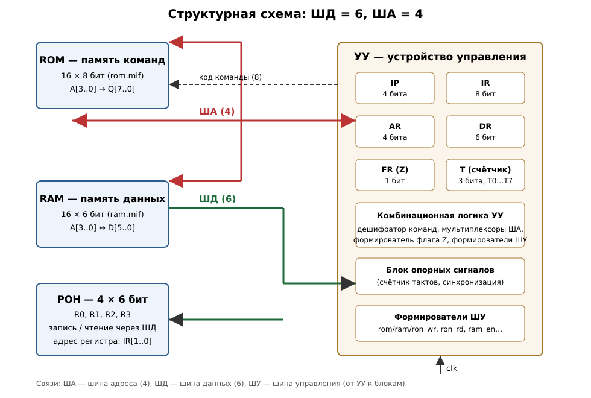

# Лабораторная работа № 4

## Считывание, декодирование и выполнение команд. Способы адресации операндов

**Вариант:** шина данных (ШД) — **6 бит**, шина адреса (ША) — **4 бита**;
команда 1 — **M → R** с **прямой** адресацией операнда-источника;
команда 2 — **JZ** с **непосредственной** адресацией адреса перехода;
блок РОН — **4 регистра**.

Проект Quartus II 9.1: `lab4.qpf` / `lab4.qsf`, верхний уровень — `laba4.bdf`.

---

## 1. Задание

1. Разработать архитектуру системы команд (АСК) для выданного варианта.
2. Ввести ША, ШД и ШУ.
3. Разделить память на память данных (RAM) и память команд (ROM); адресные входы
   обеих подключить к ША; ввод/вывод данных — через ШД.
4. Ввести блок РОН (4 регистра) и управляющую логику для него.
5. Написать микропрограмму из 4–6 вызовов команд с конкретными адресами и регистрами.
6. Записать микропрограмму в ROM (`rom.mif`), данные — в RAM (`ram.mif`).
7. Разработать УУ, которое считывает, декодирует и выдаёт управляющие сигналы.
8. Ввести специальные регистры, размещённые в блоке УУ.
9. Промоделировать схему.

---

## 2. Архитектура системы команд (АСК)

### 2.1 Шины и разрядности

| Шина | Обозначение в схеме | Разрядность | Назначение |
|---|---|---|---|
| Шина адреса | `address[3..0]` | 4 | адрес ячейки ROM/RAM (16 ячеек) |
| Шина данных | `data_io[5..0]` | 6 | обмен данными RAM ↔ РОН ↔ УУ |
| Шина управления | набор сигналов УУ | — | `ram_en`, `ram_wr`, `ron_wr`, `ron_rd`, `ron_addr[1..0]` |

Адресные входы ROM **и** RAM заведены на одну и ту же ША (п. 3 задания).
Шина данных — двунаправленная, с тремя формирователями (RAM, РОН, DR в УУ).

### 2.2 Память и регистры

| Блок | Организация | Файл инициализации |
|---|---|---|
| ROM — память команд | 16 слов × **8 бит** | `rom.mif` |
| RAM — память данных | 16 слов × **6 бит** | `ram.mif` |
| РОН | 4 регистра × **6 бит** (R0…R3) | инициализация не требуется |

### 2.3 Формат команды

Слово команды — **8 бит**:

```
 7   6 │ 5  4  3  2 │ 1  0
───────┼────────────┼──────
  КОП  │    ADR     │  R
 (2)   │    (4)     │ (2)
```

* **КОП** — код операции (2 бита);
* **ADR** — адресное поле: физический адрес операнда в RAM для `MOV`
  либо адрес перехода для `JZ`;
* **R** — номер регистра-приёмника РОН (2 бита), для `JZ` не используется (`00`).

> Почему слово команды шире ШД (8 > 6): в формате команды нужно разместить
> и 4-битный адрес, и 2-битный номер регистра, и код операции —
> всего 8 бит. Такая же ситуация в примере из методички, где при ШД = 6
> команда занимает 12 бит (`КОП x REG ADR`). Поэтому ROM имеет собственную
> 8-разрядную выходную шину `rom_data[7..0]`, которая идёт в регистр команд IR.
> Регистры AR (4 бита) и DR (6 бит), а также ШД (6 бит) строго соответствуют
> разрядностям ША и ШД.

### 2.4 Кодирование операций

| КОП | Команда | Формат | Действие |
|---|---|---|---|
| `00` | NOP | `00 xxxx xx` | нет операции |
| `01` | **MOV M→R** | `01 ADR R` | `R ← M[ADR]`; `Z ← (M[ADR] == 0)` |
| `10` | **JZ $ADR** | `10 ADR 00` | если `Z = 1`, то `IP ← ADR`, иначе `IP ← IP + 1` |
| `11` | JMP $ADR *(резерв)* | `11 ADR 00` | безусловный переход `IP ← ADR` |

**Способы адресации по варианту:**

* **MOV M → R, прямая адресация:** в команде указывается физический адрес
  операнда в RAM (`ADR`) и номер регистра-приёмника (`R`).
  `Операнд = M[ADR]`, результат пишется в `R`.
* **JZ, непосредственная адресация:** адрес перехода находится непосредственно
  в команде (поле `ADR`), никаких дополнительных выборок из памяти нет:
  `IP ← ADR`.

Флаг `Z` (нулевой результат) — единственный флаг, используемый командой `JZ`.
Он устанавливается каждой командой `MOV` по значению переданного операнда
и хранится в регистре флагов `FR`.

---

## 3. Структурная схема



Текстовое описание связей:

* УУ выдаёт адрес на ША (мультиплексор: `IP` при выборке команды, `AR` при обращении к операнду);
* ША → адресные входы ROM и RAM;
* ROM → `rom_data[7..0]` → IR (регистр команд внутри УУ);
* RAM ↔ ШД (чтение — через формирователь с сигналом `ram_en`);
* РОН ↔ ШД (запись — `ron_wr`, чтение — `ron_rd`, адрес регистра — `IR[1..0]`);
* DR внутри УУ выдаёт данные на ШД при записи в РОН (`dr_out`);
* УУ формирует ШУ для RAM, РОН и внутренних регистров.

---

## 4. Устройство управления (УУ)

### 4.1 Специальные регистры (внутри блока `uu`)

| Регистр | Разрядность | Назначение |
|---|---|---|
| **IP** (PC) | 4 | счётчик команд: адрес очередной команды |
| **IR** | 8 | регистр команд (равен разрядности слова команды) |
| **AR** | 4 | регистр адреса операнда (равен разрядности ША) |
| **DR** | 6 | регистр данных (равен разрядности ШД) |
| **FR** | 1 | регистр флагов: флаг `Z` (результат равен нулю) |
| **T** | 3 | счётчик тактов автомата: состояния `T0…T7` |

### 4.2 Автомат выполнения команды

Каждая команда выполняется за фиксированные 8 тактов (счётчик `T` свободно
считает по синхросигналу; реально используются `T0…T4`, такты `T5…T7` — резерв).

**Выборка команды (общая для всех команд):**

| Такт | Действие |
|---|---|
| `T0` | ША ← IP (мультиплексор в положении «IP»), ROM читает слово по адресу IP |
| `T1` | `IR ← ROM[IP]`; `IP ← IP + 1` |

**Выполнение MOV M → R:**

| Такт | Действие |
|---|---|
| `T2` | `AR ← IR[5..2]` (поле ADR) |
| `T3` | ША ← AR; RAM выдаёт `M[AR]` на ШД; `DR ← ШД` |
| `T4` | DR выдаёт данные на ШД; `R[IR[1..0]] ← ШД`; `FR.Z ← (DR == 0)` |

**Выполнение JZ $ADR:**

| Такт | Действие |
|---|---|
| `T2` | (декодирование) |
| `T3` | если `Z = 1`, то `IP ← IR[5..2]` (непосредственный адрес из команды) |

### 4.3 Управляющие сигналы (ШУ)

Обозначения: `mov = ~IR[7] & IR[6]`; `jump = IR[7] & (IR[6] | Z)`.

| Сигнал | Формула | Назначение |
|---|---|---|
| `sel_sha` | `T3 & mov` | выбор источника ША: 0 — IP, 1 — AR |
| `ir_ld` | `T1` | запись IR из ROM |
| `ip_en` | `T1 + (T3 & jump)` | разрешение записи IP |
| `ip_jump` | `T3 & jump` | выбор на входе IP адреса перехода `IR[5..2]` вместо `IP+1` |
| `ar_ld` | `T2 & mov` | запись AR из поля ADR |
| `ram_en` | `T3 & mov` | выдача данных RAM на ШД |
| `dr_ld` | `T3 & mov` | запись DR с ШД |
| `dr_out` | `T4 & mov` | выдача DR на ШД |
| `ron_wr` | `T4 & mov` | запись в РОН |
| `ron_addr[1..0]` | `IR[1..0]` | адрес регистра РОН |
| `fr_ld` | `T4 & mov` | запись флага `Z` |
| `ram_wr` | `0` | запись в RAM в данной АСК не используется (резерв) |
| `ron_rd` | `0` | чтение РОН в данной АСК не используется (резерв) |

### 4.4 Формирование флага Z

```
Z = NOT( DR[5] OR DR[4] OR DR[3] OR DR[2] OR DR[1] OR DR[0] )
```

Флаг записывается в `FR` в такте `T4` команды `MOV` и анализируется
в такте `T3` команды `JZ` (к этому моменту предыдущая команда уже завершилась,
поэтому значение `Z` всегда актуально).

---

## 5. Микропрограмма

### 5.1 Символьная запись

| Адрес | Команда | Комментарий |
|---|---|---|
| `00` | `MOV M[4], R0` | `R0 ← 0Ah`, `Z = 0` |
| `01` | `JZ $3` | `Z = 0` → **перехода нет**, идём на `02` |
| `02` | `MOV M[5], R1` | `R1 ← 15h`, `Z = 0` |
| `03` | `MOV M[6], R2` | `R2 ← 2Ah`, `Z = 0` |
| `04` | `MOV M[7], R3` | `R3 ← 00h`, `Z = 1` |
| `05` | `JZ $0` | `Z = 1` → **переход есть**, возврат на `00` (цикл) |
| `06…0F` | `NOP` | не используются |

В микропрограмме задействованы все четыре регистра РОН, обе команды варианта
и показаны оба исхода условного перехода: `JZ $3` (перехода нет) и `JZ $0`
(переход есть).

### 5.2 Числовой код программы

| Адрес | КОП | ADR | R | Двоичный код | Hex |
|---|---|---|---|---|---|
| `00` | `01` | `0100` | `00` | `0101 0000` | **`50`** |
| `01` | `10` | `0011` | `00` | `1000 1100` | **`8C`** |
| `02` | `01` | `0101` | `01` | `0101 0101` | **`55`** |
| `03` | `01` | `0110` | `10` | `0101 1010` | **`5A`** |
| `04` | `01` | `0111` | `11` | `0101 1111` | **`5F`** |
| `05` | `10` | `0000` | `00` | `1000 0000` | **`80`** |

### 5.3 Память команд — `rom.mif`

```
DEPTH = 16;  WIDTH = 8;  ADDRESS_RADIX = HEX;  DATA_RADIX = HEX;
CONTENT BEGIN
  00 : 50;   01 : 8C;   02 : 55;   03 : 5A;   04 : 5F;   05 : 80;
  [06..0F] : 00;
END;
```

### 5.4 Память данных — `ram.mif`

```
DEPTH = 16;  WIDTH = 6;  ADDRESS_RADIX = HEX;  DATA_RADIX = HEX;
CONTENT BEGIN
  [00..03] : 00;
  04 : 0A;   -- R0 = 10  (Z = 0)
  05 : 15;   -- R1 = 21  (Z = 0)
  06 : 2A;   -- R2 = 42  (Z = 0)
  07 : 00;   -- R3 = 0   (Z = 1)
  [08..0F] : 00;
END;
```

Ожидаемый результат выполнения: `R0 = 0Ah`, `R1 = 15h`, `R2 = 2Ah`, `R3 = 00h`,
после чего программа бесконечно повторяется (цикл `00 → 05 → 00`).

---

## 6. Трасса выполнения по тактам

Первые две команды и переход по `JZ` (полная трасса — 8 тактов на команду):

| T | ША | ROM | IR | Команда в IR | Управляющие сигналы |
|---|---|---|---|---|---|
| 0 | 0 | 50 | 00 | NOP | — |
| 1 | 0 | 50 | 00 | NOP | `IR←ROM`, `IP+1` |
| 2 | 1 | 8C | 50 | `MOV M[4], R0` | `AR←4` |
| 3 | 4 | 5F | 50 | `MOV M[4], R0` | `ША←AR`, `RAM→ШД`, `DR←ШД` |
| 4 | 1 | 8C | 50 | `MOV M[4], R0` | `DR→ШД`, `РОН[R0]←ШД`, `FR←Z` |
| 5…7 | 1 | 8C | 50 | `MOV M[4], R0` | — |
| 0 | 1 | 8C | 50 | `MOV M[4], R0` | — |
| 1 | 1 | 8C | 50 | `MOV M[4], R0` | `IR←ROM`, `IP+1` |
| 2 | 2 | 55 | 8C | `JZ $3` | — |
| 3 | 2 | 55 | 8C | `JZ $3` | — (`Z = 0`, перехода нет) |
| … | | | | | |
| 1 | 5 | 80 | 5F | `MOV M[7], R3` | `IR←ROM`, `IP+1` |
| 2 | 6 | 00 | 80 | `JZ $0` | — |
| 3 | 6 | 00 | 80 | `JZ $0` | `IP←ADR = 0` (переход есть, `Z = 1`) |
| 4 | 0 | 50 | 80 | `JZ $0` | — |

---

## 7. Реализация в Quartus II 9.1

### 7.1 Состав проекта

| Файл | Содержимое |
|---|---|
| `lab4.qpf`, `lab4.qsf` | проект, верхний уровень `laba4` |
| `laba4.bdf` | структурная схема верхнего уровня (УУ + ROM + RAM + РОН) |
| `uu.bdf` | устройство управления: IP, IR, AR, DR, FR, счётчик T, дешифраторы, мультиплексоры, формирователи ШУ |
| `ron.bdf` | блок РОН: 4 регистра по 6 бит, дешифратор записи, мультиплексор чтения, формирователь |
| `rom.bdf` | память команд: `lpm_rom0` (16 × 8) + `rom.mif` |
| `ram.bdf` | память данных: `lpm_ram_dq0` (16 × 6) + `ram.mif` |
| `rom.mif`, `ram.mif` | содержимое памяти команд и данных |
| `lpm_*.v/.bsf/.qip` | мегафункции LPM |
| `lab4.vwf` | временные диаграммы для функционального моделирования |
| `docs/ОТЧЕТ.md`, `docs/scheme.svg` | этот отчёт и структурная схема |

### 7.2 Настройки мегафункций

| Мегафункция | Назначение | Параметры |
|---|---|---|
| `lpm_rom0` | память команд | 16 слов × 8 бит, `init_file = rom.mif` |
| `lpm_ram_dq0` | память данных | 16 слов × 6 бит, `init_file = ram.mif` |
| `lpm_dff0` | IR | 8 бит, со входом `enable` |
| `lpm_dff1` | AR, IP | 4 бита, со входом `enable` |
| `lpm_dff2` | DR, R0…R3 | 6 бит, со входом `enable` |
| `lpm_dff3` | FR | 1 бит, со входом `enable` |
| `lpm_mux0` | мультиплексор чтения РОН | 4:1, 6 бит |
| `lpm_mux1` | мультиплексоры ША и входа IP | 2:1, 4 бита |
| `lpm_add_sub0` + `lpm_constant0` | сумматор `IP + 1` | 4 бита, константа 1 |
| `lpm_decode0` | дешифратор адреса РОН | 2 → 4, со входом `enable` |
| `lpm_decode1` | дешифратор тактов | 3 → 8 (`T0…T7`) |
| `lpm_counter0` | счётчик тактов | 3 бита |
| `lpm_bustri0` | формирователи ШД | 6 бит (3 экземпляра) |

### 7.3 Порядок сборки и моделирования

1. Открыть `lab4.qpf` в Quartus II 9.1.
2. **Processing → Start Compilation** (полная компиляция).
3. Моделирование: открыть **`lab4.vwf`** (File → Open), затем
   **Simulation → Run Functional Simulation** (в проекте уже задано
   `SIMULATION_MODE = FUNCTIONAL`).
4. На диаграммах контролировать: `clk`, `adr_out` (ША), `data_out` (ШД),
   `ir_out` (регистр команд), `T_out` (такт), `flag_out` (флаг Z),
   `ron_wr_out`, `ram_en_out`.

Так как регистры схемы не имеют входа сброса, при функциональном моделировании
они начинают работу с нуля (`IP = 0`, `T = 0`) — этого достаточно, чтобы
программа пошла с адреса `00`.

---

## 8. Отличия от предыдущей версии проекта

| Параметр | Было (исходный проект) | Стало (этот вариант) |
|---|---|---|
| ШД | 9 бит | **6 бит** |
| ША | 6 бит (64 ячейки) | **4 бита (16 ячеек)** |
| ROM | 64 × 9 | **16 × 8** |
| RAM | 64 × 9 | **16 × 6** |
| РОН | 4 × 9 | **4 × 6** |
| Команда 1 | `Mov` (M → R), косвенная адресация | **`MOV M → R`, прямая адресация** |
| Команда 2 | `JS` (переход по знаку), относительная со смещением | **`JZ` (переход по нулю), непосредственная** |
| Флаг | знак результата (`DR[8]`) | **нулевой результат** (свёртка по ИЛИ всех разрядов DR) |
| IR / AR / DR | 9 / 6 / 9 | **8 / 4 / 6** |
| Шина команд | ROM выдавал слово на ШД | **ROM выдаёт слово в IR по отдельной шине** (слово команды шире ШД) |

> Примечание: в исходном проекте фактически `rom.mif`/`ram.mif` имели
> организацию 64 × 9, то есть ШД = 9 бит, ША = 6 бит. В новом варианте
> разрядности приведены к заданию: ШД = 6, ША = 4.

---

## 9. Что показывать на защите

1. **АСК** — п. 2: формат команды, кодирование КОП, способы адресации, разрядности.
2. **Код программы в символьном и числовом виде** — п. 5.1 и 5.2.
3. **Структурная схема** — `docs/scheme.svg` и `laba4.bdf`.
4. **УУ**: автомат `T0…T7`, таблица управляющих сигналов, спецрегистры.
5. **Содержимое памяти** — `rom.mif`, `ram.mif`.
6. **Временные диаграммы** — `lab4.vwf` (видно выборку команды, чтение RAM,
   запись РОН, изменение флага Z и переходы `JZ`).
